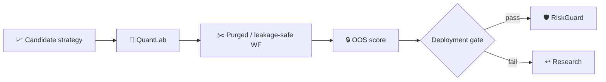

# SYNERGY QuantLab

> **Leakage-safe strategy validation, purged walk-forward, OOS scoring and deployment gates**

Version: `2.0.0`

**Enterprise v2.0.0** · FastAPI/OpenAPI · Docker/Compose · RBAC/JWT · PostgreSQL/ClickHouse audit

**Designed for:** Quant funds, prop firms, systematic asset managers and broker research desks  
**Primary endpoint:** `POST /enterprise/v1/validation/evaluate`

> [!IMPORTANT]
> Validation infrastructure only. A passing backtest/OOS gate does not guarantee future investment returns.

## Institutional package
Cost-aware validation · explicit deployment gate · tenant RBAC · request-ID audit · metrics · Docker/Compose · due-diligence/pilot documentation.

## Verification
**21 tests passed** · health smoke **80/80 200** · local p95 **84.8 ms** (~478 req/s). Health smoke only.

## Quick start
```bash
pip install -e '.[dev,enterprise]'
pytest -q
python -m synergy_quantlab.api
```

## CTO package
[Due diligence](docs/CTO_DUE_DILIGENCE.md) · [Architecture](docs/ARCHITECTURE_DIAGRAMS.md) · [API](docs/API_EXAMPLES.md) · [Security](SECURITY.md) · [Benchmarks](docs/BENCHMARKS_AND_ACCEPTANCE.md) · [SLA/SLO](docs/SLA_SLO.md) · [Deployment](docs/DEPLOYMENT_CHECKLIST.md) · [Pilot](docs/CUSTOMER_PILOT.md)


---

# 🧪 Место QuantLab в SYNERGY

`synergy_quantlab` — validation authority для торговых исследований, но **не authority будущей доходности**.



## Воспроизводимость

Уже заявленные `21 tests passed`, health smoke `80/80 200` и локальные latency/throughput числа следует трактовать строго в указанном контексте: health smoke не является доказательством alpha, а локальная API-производительность не является production SLA.

## Интеграции

- [`synergy_midas_ai`](https://github.com/Shtenco/synergy_midas_ai);
- [`synergy_riskguard`](https://github.com/Shtenco/synergy_riskguard);
- [`synergy_agi_trader`](https://github.com/Shtenco/synergy_agi_trader);
- [`synergy_midas_institutional`](https://github.com/Shtenco/synergy_midas_institutional).

[📚 Атлас 75 репозиториев](https://github.com/Shtenco/synergy_system/blob/main/docs/SYNERGY_REPOSITORY_ATLAS.md)
