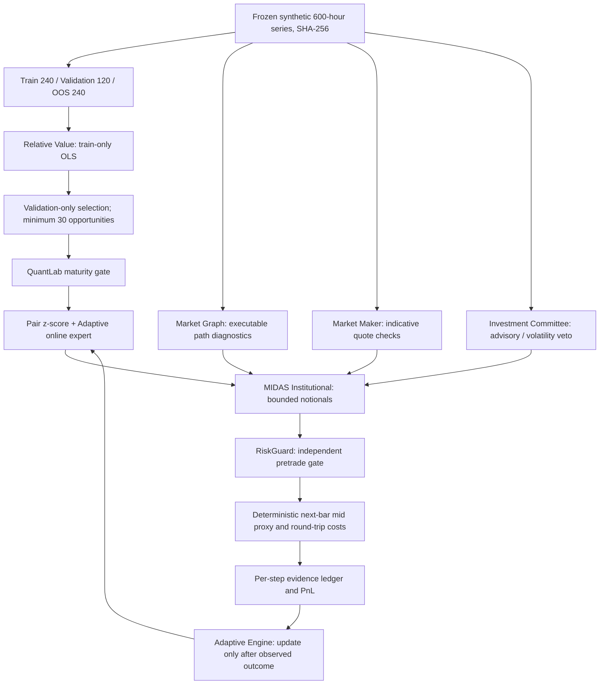

# SYNERGY QuantLab — Federated Scientific Integration Benchmark V1

**Executable, source-pinned, synthetic, read-only benchmark.** This project connects eight independently maintained SHTENCO modules using their actual Python interfaces. It does **not** train a new RL/LLM model, query a live broker, send orders, or establish trading profitability. Its goal is a rigorous foundation for future real-data experiments.

## Research architecture



### Connected real source modules

| Owner | Role in protocol | Source |
|---|---|---|
| `synergy_relative_value` | Training-only OLS pair model, frozen z-score | `src/synergy_relative_value/core.py` |
| `synergy_market_graph` | Directed price/fee route diagnostics | `src/synergy_market_graph/core.py` |
| `synergy_ai_investment_committee` | Heuristic deliberation and volatility veto | `src/synergy_ai_committee/core.py` |
| `synergy_market_maker` | Indicative bid/ask with inventory constraints | `src/synergy_market_maker/core.py` |
| `synergy_midas_institutional` | Independent validator and notional cap | `src/synergy_midas/core.py` |
| `synergy_riskguard` | Kill switch, VaR, drawdown and exposure veto | `src/synergy_riskguard/core.py` |
| `synergy_adaptive_engine` | Online multiplicative expert weighting | `src/synergy_adaptive_engine/core.py` |
| `synergy_quantlab` | Costed performance and maturity gate | `src/synergy_quantlab/core.py` |

**Not integrated as executable model:** `synergy_agi_trader` and broader NEXUS RL model families. Their source import, training and inference evidence must be added separately. The benchmark's two basic experts are a train-only pair model and 3-bar momentum rule; they are not called trained RL agents.

## Frozen dataset and timeline

- Synthetic generator: Python `random.Random(20261024)` with a reproducible three-regime, 600-row UTC hourly series. Not RoboForex, Bybit, or MetaTrader 5 historical data.
- Canonical CSV checksum: `b8939ed6c9aa9b5d030aeee746ecf520a554d1eb8e9fe726211e3da4759e669a`.
- **Train:** rows `[0,240)`; **validation:** `[240,360)`; **sealed OOS:** `[360,600)`.
- Since each one-bar outcome uses the next bar, each evaluated split ends one bar before the split boundary; validation does not read row 360 to score a trade.
- Four validation candidate thresholds: `0.35, 0.65, 1.0, 1.4`. Selection maximizes validation net sum **among candidates with at least 30 signals**. No OOS information affects selection.
- On OOS, reward updates happen only **after** that step's next-bar outcome becomes available. Expert shadow rewards include the same simplified trading-cost model.

## Transaction ledger and economics

Each notional position `N` is held for one step. Gross marked-to-next-bar return is the signed change in mid multiplied by `N`. Fixed fees are **1 basis point per side**, modeled slippage **1 basis point per side**; observed synthetic spread is additionally charged for the round trip:

$$
C_t=\frac{|N_t|}{10000}\left(\operatorname{spreadBps}_t+4\right).
$$

$$
PnL_t=N_t\cdot s_t\left(\frac{P_{t+1}}{P_t}-1\right)-C_t.
$$

`P_{t+1}` is never used for signal construction at t. This is a **midpoint proxy**, not executable order book fill modelling. There is no intrabar stop execution, funding, latency arb, partial fill or real market impact. Trade quantities, zero position costs and risk states are logged.

## Scientifically interpretable comparisons

Four OOS scenarios use the same generator and per-bar friction formula: integrated (pair + momentum weighted online with committee, maker, MIDAS, RiskGuard), pair-only (MIDAS + committee/maker but independent RiskGuard bypassed as an ablation), a fixed momentum baseline (same exposure sizing), and flat/no-trade. This isolates useful controls only partly; future versions should add full factorial ablations.

A strategy is **not considered superior** if it merely displays better uncosted gross PnL. Compare net USD, return, cost, trade count, max drawdown, hit rate and sensitivity across many unseen seeds (seeds beyond the frozen one are a separate experiment, not merged into this first OOS).

## How to reproduce with real pinned code

```bash
python -m venv .venv
# activate it on your OS
python -m pip install numpy pandas pytest
bash benchmarks/federated_v1/fetch_pinned.sh /path/to/checkout-parent
python benchmarks/federated_v1/run.py \
  --sibling-root /path/to/checkout-parent \
  --output benchmarks/federated_v1/artifacts
python -m pytest -q tests/test_benchmark.py
```

`fetch_pinned.sh` clones all eight real repositories and pins exact commit IDs, listed in the script and `run.py`. Requires network access on the machine running it. The harness aborts if a source tree is missing; it does **not** silently substitute a synthetic copy of a research module. Continuous integration is specified under `.github/workflows/federated-benchmark.yml`.

## Evidence, maturity and scientific limitations

Tests under `tests/` use local contract-compatible **test doubles** for a no-network harness smoke. These tests verify dataset determinism, absence of validation contamination by OOS, accounting consistency, and fail-closed module loading. They do **not** independently validate the eight upstream Python packages. Run the separate CI job with cloned pinned code before claiming real-source integration success.

The included example ledger and metrics were generated in a local mock-backend smoke and are marked as such. A future production result needs broker timestamps, tick bid/ask, full account exposure, financing, execution receipts, trade lifecycle, frozen market-sourced data, independent model training and multi-seed walk-forward testing.

**Promotion rule:** simulated engineering evidence -> independently reproduced pinned-source integration -> chronological market-data OOS -> paper execution -> narrowly authorized canary. No skipping stages from narrative confidence.